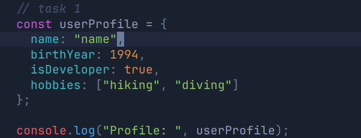
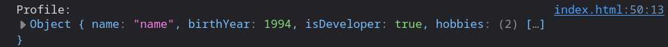
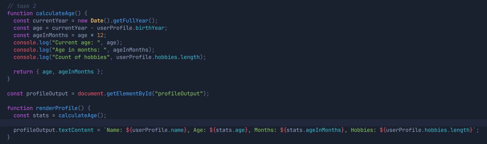
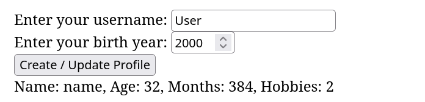
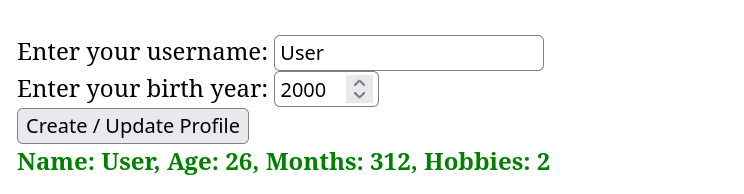
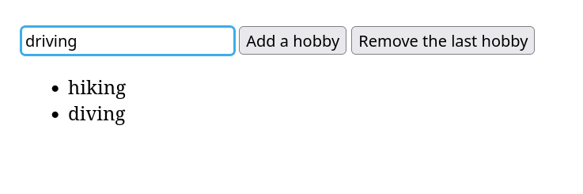
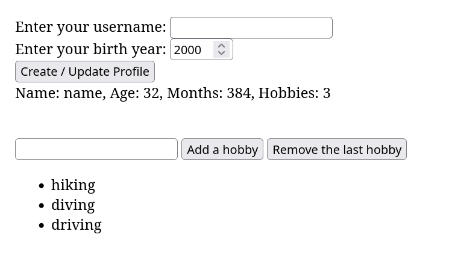

# Assignment 5

Fulname: Ilya Koval
Group: SE-2539

## Part 1

### Task 1

Created a const object named userProfile that stores different data types:

The object is printed to the console with `console.log()`.

### Task 2. Arithmetic Calculations

The function calculateAge() gets the current year dynamically with `new Date().getFullYear()` and uses arithmetic operators to calculate
current age, age in months.

The values are printed to the console and displayed on the page by the `renderProfile()` function.

## Part 2

### Task 3

Created a form with an input for username, birth year and a submit button.

### Task 4

Added a submit event listener to the form. When the button is clicked:

1. `event.preventDefault()` prevent the page from reloading.
2. The input values are captured and written to the existing `userProfile` object.
3. The age is recalculated and the profile info on the page is updated.
4. The output text style is changed with `classList.add("updated")` (green and bold).

## Part 3

### Task 5

- An unordered list `<ul>` displays the hobbies from `userProfile.hobbies`.
- The **"Add a hobby"** button takes the text from the input, checks that it is not empty, adds it to the array and creates a new `<li>` with `document.createElement()`.
- The **"Remove the last hobby"** button removes the last hobby with `pop()`, and the list is re-rendered.
- After each change, the hobbies count in the profile info is updated as well.

Before adding:

After adding:

## Summary

First, I set up the HTML structure by creating a profile form, an output block and a hobbies section with a list. Then I created the userProfile object and wrote a function that calculates the age and age in months using arithmetic operators.After that, I added event listeners. For the profile form I used the submit event and preventDefault(), so the data is updated without reloading the page. For the hobbies list I wrote a renderHobbies() function that clears the list and rebuilds it from the array, so the page always matches the data in the object.

## GitHub Pages
<https://anommanager.github.io/web-assignment5/>
